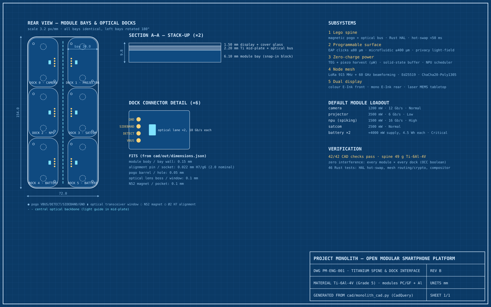

# Project Monolith

An open-source modular smartphone platform, developed in simulation first. The repo contains a parametric titanium spine and snap-in modules (CadQuery), a Rust hot-swap HAL for the magnetic/optical module bus, a LoRa + 60 GHz mesh stack, an E-Ink/tabletop-projector compositor, and a browser dashboard that runs all of it through WebAssembly.

| Path | What it is |
|------|------------|
| `cad/` | `monolith_cad.py`: parametric spine (154 × 72 × 9.8 mm, Ti-6Al-4V) + 5 snap-in modules → STEP/STL + `out/dimensions.json` with 42 automated fit/interference checks |
| `firmware-hal/` | Rust HAL: Optical Bus Protocol framing (CRC-32), Ed25519 module auth, power/bandwidth allocator with priority shedding, dynamic device tree, hot-plug state machine, energy harvesting daemon, tactile driver, privacy light-field controller |
| `mesh-net/` | Signed link-state routing over LoRa + mmWave PHY models, X25519/ChaCha20-Poly1305 end-to-end envelopes, multi-node network simulation |
| `compositor/` | IMU pose detection, E-Ink waveform scheduler, projector state machine with IR beam interlock, keystone homography + touch mapping |
| `simulator/engine/` | `wasm-bindgen` wrapper exposing the crates above to JavaScript |
| `simulator/web/` | React + Three.js dashboard (5 tabs, one per subsystem) |
| `docs/` | `blueprint.svg` (generated from the CAD by `make_blueprint.py`) and `feasibility.md` |



## Quick start

Requirements: Rust (stable) with `wasm-pack`, Node 20+, and Python 3.10+ with `cadquery`.

```bash
# CAD: regenerate geometry + run dimensional checks
pip install cadquery
python3 cad/monolith_cad.py --web ../simulator/web/public/models

# Firmware / mesh / compositor tests (46 tests, incl. hot-swap soak)
cargo test --workspace

# Dashboard
cd simulator/web
npm install
npm run wasm      # builds simulator/engine to src/wasm
npm run dev       # http://localhost:5173
```

## Hot-swap in brief

1. Magnet seats the module and the DETECT pogo goes low.
2. HAL brings up the optical lanes and sends `Hello`.
3. The module replies with its descriptor + manufacturer endorsement and signs a slot-bound challenge.
4. The allocator grants power/bandwidth, shedding lower-priority modules if needed.
5. A device-tree node is inserted and the generation increments.

Accepted attaches finish in about 10 ms of simulated time against a 50 ms deadline. Surprise removal, heartbeat loss, overcurrent and battery removal under load are all handled without a reboot (`firmware-hal/tests/hotswap.rs`).

## Status

This is a simulation and specification. See [`docs/feasibility.md`](docs/feasibility.md) for which parts are buildable today. In short: the spine, mesh and local-first OS are realistic; "zero-charge" harvesting covers only an always-on tier (about 0.1% of a phone's daily energy), and the flat-lying 20″ projector needs a raised exit pupil.
